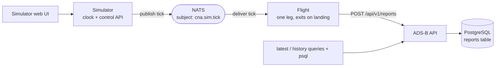

# Architecture and progress

This describes how the components fit together today and what is and isn't built
yet. See [README.md](README.md) to run the demo.

## Overview



Press play in the Simulator; its clock advances and publishes ticks to NATS; the
Flight computes its state from each tick and posts a position report to ADS-B;
ADS-B stores it and serves latest/history queries. The Flight exits when it lands.

## Components and status

| Component | Status | Notes |
| --- | --- | --- |
| Simulator | **Working** | Python/FastAPI. Clock + web UI; publishes ticks to NATS. Starts paused. |
| Flight | **Working** | Go. Subscribes to ticks, calculates state (pure function of plan + simulated time), posts reports to ADS-B, exits on landing. |
| ADS-B | **Working** | Rust/Axum/PostgreSQL. Flight registry (`/api/v1/flight`) plus position reports (`/api/v1/reports`). |
| NATS | **Working** | Core pub/sub for tick delivery. |
| Operations | Not built | Will own the aircraft registry, schedules, assignments, and the "one leg at a time / depart where you landed" invariant; consumes the Flight's departure/arrival events. |
| Flight Tracker | Not built | Will render positions from ADS-B (replacing the current `psql`/API inspection). |
| FIDS | Not built | Departures/arrivals board. |

## Contracts

**Tick** (NATS subject `cna.sim.tick`, JSON):

```json
{"run_id":"sim-…","tick_id":42,"simulated_at":"2026-10-06T14:30:00Z","paused":false,"speed":60.0,"tick_interval_s":1.0}
```

The Flight binds to the first `run_id` it sees and recomputes state from the
absolute `simulated_at`, so duplicate ticks don't double-move it and a missed
tick is self-correcting. It ignores ticks for other runs.

**Report** (`POST /api/v1/reports`, JSON):

```json
{"report_id":"<run>-<aircraft>-<tick>","run_id":"…","tick_id":42,"aircraft_id":"N100CA","flight_id":"CNA100",
 "simulated_at":"2026-10-06T14:30:00Z","latitude":43.4,"longitude":-90.5,
 "altitude_m":10668,"ground_speed_mps":199.0,"heading_deg":127.0,"status":"flying"}
```

ADS-B assigns `received_at`, deduplicates on `(run_id, report_id)` (identical
retries are idempotent; the same key with changed content is `409`), and supports
run-scoped reads: `GET /api/v1/reports/latest?run_id=&aircraft_id=` and
`GET /api/v1/reports?run_id=&aircraft_id=` (chronological history). Units are
metres, metres/second, and degrees `[0,360)`; status is `parked`/`flying`
(`turnaround` reserved for later).

## Tick delivery: NATS now, JetStream later

Ticks use **core NATS** pub/sub (at-most-once, fire-and-forget). This fits the
clock pulse well: ticks are ephemeral and idempotent, and the Flight only needs
the latest one. No stream setup is required.

**JetStream** (NATS' built-in persistence layer) is the planned next step. It adds
durable streams, acknowledgements, replay, and per-consumer pending/lag metrics —
the "is the fleet keeping up?" signal — and lets a late-joining Flight get the
last tick immediately. Because delivery sits behind a small transport seam in the
Simulator (and the Flight's tick handling is transport-agnostic), swapping to
JetStream — or demonstrating Kafka/MQTT variants — is a contained change and a
nice observability story.

## Validation performed

- `docker compose up --build -d` brings up PostgreSQL, ADS-B, NATS, the Simulator
  (paused), and the Flight (subscribed, idle).
- Pressing play (via the UI or `POST /control/resume`) and letting the clock run
  produced a full ADS-B track for run `sim-…`, aircraft `N100CA`: climb (altitude
  and speed ramping up), cruise at 10,668 m / ~199 m/s, descent, and a final
  `parked` report at ORD. The Flight container then exited `0`.
- Verified idempotent re-POST (`200`) and changed-content conflict (`409`) on the
  reports endpoint, and the `latest`/`history` queries.
- Component unit tests pass: Simulator (clock + API), Flight (flight calc +
  engine), ADS-B (report + flight validation).

## Observability status

Intentionally minimal. The services emit basic application logs (Simulator and
Flight as structured JSON with run/tick/aircraft/flight identifiers; ADS-B to
stdout). There are **no metrics, traces, or OpenTelemetry instrumentation**, and
that is deliberate for now — these uninstrumented services are a good future
target for **auto-instrumentation** (e.g. eBPF or an OTel operator), which needs
no code or app-config changes. We are not hand-wiring telemetry signals yet.

## Resetting and re-running

A Flight runs one leg and exits. To fly again: `docker compose down && up` (add
`-v` to also clear the ADS-B history), or press **Reset** in the UI, relaunch the
Flight (`docker compose up -d flight`), and press **Play**. A fresh PostgreSQL
volume is required only to wipe accumulated report history; different runs are
already distinguishable by `run_id`.

## Build sources

Compose builds each service from a sibling checkout: `ADSB_SOURCE` (`../adsb`),
`SIM_SOURCE` (`../simulator`), `FLIGHT_SOURCE` (`../flight`). PostgreSQL uses the
pinned `postgres:16-alpine` image; NATS uses `nats:2.10-alpine`.
