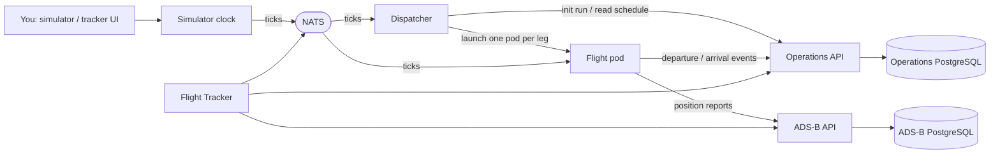

# Cloud Native Airlines

Cloud Native Airlines is an observability demo built around a simulated airline.
This repository is the entrypoint for project docs and local integration via
Docker Compose. Application code lives in the component repositories.

The demo flies a repeating four-leg tour — **RST → MSP → SFO → ATL → RST** — for a
single aircraft (`N100CA`) on a controllable simulation clock. **Operations** owns
the schedule; a **Dispatcher** launches one ephemeral **Flight** container per leg
as simulated time reaches each departure; each Flight reports its position to
**ADS-B** and its departure/arrival to Operations, then exits on landing. Watch it
on the **Flight Tracker** map, or query ADS-B and Operations directly.

The pod-per-leg model is the point of the demo: lots of short-lived jobs starting
and stopping against a durable control plane.

## Components

| Component | Responsibility | Repository |
| --- | --- | --- |
| Simulator | Simulation clock + web UI; publishes ticks (speed, pause/resume, reset) | [simulator](https://github.com/cloud-native-airlines/simulator) |
| Dispatcher | Flies a tour: reads the schedule from Operations and launches one ephemeral Flight container per leg on the simulated clock | [dispatcher](https://github.com/cloud-native-airlines/dispatcher) |
| Flight | Executes one leg; calculates state per tick, reports position to ADS-B and departure/arrival to Operations, exits on landing | [flight](https://github.com/cloud-native-airlines/flight) |
| Operations | Fleet, airports, routes, schedules, flight status; materializes a run's schedule and derives each aircraft's location | [operations](https://github.com/cloud-native-airlines/operations) |
| ADS-B | Stores position reports in PostgreSQL; serves latest position, history, and viewport queries | [adsb](https://github.com/cloud-native-airlines/adsb) |
| Flight Tracker | Map of aircraft positions and tracks, with simulation controls | [flight-tracker](https://github.com/cloud-native-airlines/flight-tracker) |
| FIDS | Departures and arrivals for a configured airport | [fids](https://github.com/cloud-native-airlines/fids) _(future)_ |

Ticks are delivered over **NATS**; Flight posts position reports to ADS-B and
lifecycle events to Operations over HTTP; the Dispatcher launches Flight
containers through the host Docker socket.

## Architecture



## Run the demo

Prerequisites: Docker Compose, and the sibling component checkouts beside this
repo — `../adsb`, `../simulator`, `../flight`, `../operations`, `../dispatcher`,
`../flight-tracker` (override with `ADSB_SOURCE`, `SIM_SOURCE`, `FLIGHT_SOURCE`,
`OPERATIONS_SOURCE`, `DISPATCHER_SOURCE`, `FLIGHT_TRACKER_SOURCE`).

```sh
docker compose build flight    # the per-leg image: built, but not started (the dispatcher launches it)
docker compose up -d --build
```

This starts PostgreSQL (one for ADS-B, one for Operations), ADS-B, NATS, the
Simulator (**paused**), Operations, the Flight Tracker, and the Dispatcher. The
Dispatcher reads the Simulator clock and materializes the run's 7-day schedule in
Operations immediately — but launches nothing while the clock is paused. Then:

1. Open the Flight Tracker at <http://localhost:8090> (or the Simulator UI at
   <http://localhost:8000>).
2. Press **Play**. The clock advances (default 60×, one tick/second). Use the
   speed/tick controls to run the tour faster or slower live.
3. As simulated time reaches each leg's departure, the Dispatcher launches a
   Flight container for it. The Flight flies the leg, streams positions to ADS-B
   and a departure/arrival to Operations, then exits on landing; the next leg
   launches after its turnaround.

Watch the pods start and stop — the ephemeral-jobs story:

```sh
docker ps -a --filter label=app=flight   # a container per leg; landed ones show Exited (0)
```

### Watch the flight's progress

Grab the current run id from the Simulator, then query ADS-B and Operations:

```sh
RUN=$(curl -s localhost:8000/clock | python3 -c 'import sys,json;print(json.load(sys.stdin)["run_id"])')

# ADS-B: latest fleet positions in the run
curl -s "localhost:18080/api/v1/positions?run_id=$RUN"

# Operations: the aircraft's current location (at an airport, or flying a leg)
curl -s "localhost:18082/api/v1/aircraft/N100CA?run_id=$RUN"

# Operations: flights in the next 6 hours of simulated time
curl -s "localhost:18082/api/v1/flights?run_id=$RUN&within=6"
```

Or inspect the ADS-B database directly:

```sh
# Report count and span per flight number
docker compose exec postgres psql -U adsb -d adsb -c \
  "SELECT flight_id, aircraft_id, count(*) AS reports,
          min(simulated_at) AS first, max(simulated_at) AS last
   FROM reports GROUP BY flight_id, aircraft_id ORDER BY first;"
```

### Run it again

The Dispatcher keeps the tour flying on its own:

- **Reset in place:** press **Reset** in the Simulator UI (new run id, clock back
  to the start, paused). The Dispatcher notices the new run, re-materializes its
  schedule in Operations, and flies it once you press **Play** again.
- **Full restart:** `docker compose down && docker compose up -d` (add `-v` to also
  clear the ADS-B and Operations data).

## Ports

| Service | URL | Override |
| --- | --- | --- |
| Simulator UI | <http://localhost:8000> | `SIM_PORT` |
| Flight Tracker | <http://localhost:8090> | `FLIGHT_TRACKER_PORT` |
| ADS-B API | <http://localhost:18080> | `ADSB_PORT` |
| Operations API | <http://localhost:18082> | `OPERATIONS_PORT` |
| Dispatcher (health) | <http://localhost:18083> | `DISPATCHER_PORT` |
| NATS monitoring | <http://localhost:8222> | `NATS_MONITOR_PORT` |

Flight containers are launched on demand and are not published on a fixed port.
The PostgreSQL instances are only reachable on the private Compose network; use
the `docker compose exec` commands above.

## Verify and clean up

```sh
docker compose ps -a                         # services; Flight pods show Exited (0) after landing
docker compose logs -f dispatcher            # follow leg launches
docker ps -a --filter label=app=flight       # the per-leg containers
docker compose down                          # stop services; keep data
docker compose down -v                       # stop services and reset PostgreSQL data
```

## Troubleshooting

- Build can't find a sibling repo: clone it beside this one, or set the matching
  `*_SOURCE` variable.
- Dispatcher logs `no such image` / nothing flies: build the per-leg image with
  `docker compose build flight` (it's a build-only service the Dispatcher launches).
- Dispatcher logs a Docker socket permission error: it needs `/var/run/docker.sock`
  (mounted in the Compose file) to launch Flight containers.
- ADS-B or Operations won't become ready: `docker compose logs adsb operations`.
  Each waits for its PostgreSQL and applies migrations at startup.
- A port is busy: set the matching `*_PORT` variable to a free host port.
