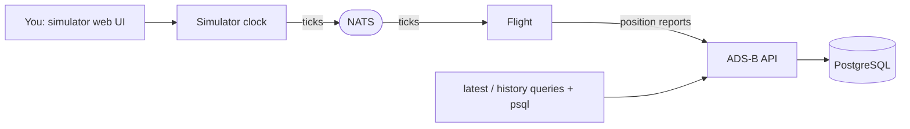

# Cloud Native Airlines

Cloud Native Airlines is an observability demo built around a simulated airline.
This repository is the entrypoint for project docs and local integration via
Docker Compose. Application code lives in the component repositories.

The first scope is a single flight (MSP→ORD) driven by a controllable simulation
clock, reporting its position to ADS-B where you can watch its progress.

## Components

| Component | Responsibility | Repository |
| --- | --- | --- |
| Simulator | Simulation clock + web UI; publishes ticks (speed, pause/resume, reset) | [simulator](https://github.com/cloud-native-airlines/simulator) |
| Flight | Executes one flight leg; calculates state per tick, reports to ADS-B, exits on landing | [flight](https://github.com/cloud-native-airlines/flight) |
| ADS-B | Stores position reports in PostgreSQL; serves latest position and history | [adsb](https://github.com/cloud-native-airlines/adsb) |
| Operations | Fleet, airports, routes, schedules, assignments, flight status | [operations](https://github.com/cloud-native-airlines/operations) _(future)_ |
| Flight Tracker | Map of aircraft positions and reporting freshness | [flight-tracker](https://github.com/cloud-native-airlines/flight-tracker) _(future)_ |
| FIDS | Departures and arrivals for a configured airport | [fids](https://github.com/cloud-native-airlines/fids) _(future)_ |

Ticks are delivered over **NATS**; the flight posts reports to ADS-B over HTTP.

## Architecture



## Run the demo

Prerequisites: Docker Compose, and the sibling component checkouts beside this
repo — `../adsb`, `../simulator`, `../flight` (override with `ADSB_SOURCE`,
`SIM_SOURCE`, `FLIGHT_SOURCE`).

```sh
docker compose up --build -d
```

This starts PostgreSQL, ADS-B, NATS, the Simulator (**paused**), and the Flight
(subscribed to ticks, waiting). Then:

1. Open the Simulator UI at <http://localhost:8000>.
2. Press **Play**. The clock advances (default 60×, one tick/second), so the
   60-minute MSP→ORD leg plays out in about one real minute. Use the ± buttons to
   speed it up or slow it down live.
3. Watch the Flight fly: it computes its position each tick and posts a report to
   ADS-B. On arrival it records its final state and the container exits.

### Watch the flight's progress in ADS-B

Grab the current run id from the Simulator (shown in the UI, or via the clock),
then query the ADS-B API:

```sh
RUN=$(curl -s localhost:8000/clock | python3 -c 'import sys,json;print(json.load(sys.stdin)["run_id"])')

# Latest position
curl -s "localhost:18080/api/v1/reports/latest?run_id=$RUN&aircraft_id=N100CA"

# Chronological history
curl -s "localhost:18080/api/v1/reports?run_id=$RUN&aircraft_id=N100CA"
```

Or inspect the database directly (a Flight Tracker UI will come later):

```sh
# The track, sampled
docker compose exec postgres psql -U adsb -d adsb -c \
  "SELECT tick_id, simulated_at, status, round(altitude_m) AS alt_m,
          round(ground_speed_mps::numeric,1) AS gs_mps,
          round(latitude::numeric,3) AS lat, round(longitude::numeric,3) AS lon
   FROM reports WHERE flight_id = 'CNA100' ORDER BY simulated_at;"

# Summary: report count and span per flight
docker compose exec postgres psql -U adsb -d adsb -c \
  "SELECT flight_id, aircraft_id, count(*) AS reports,
          min(simulated_at) AS first, max(simulated_at) AS last
   FROM reports GROUP BY flight_id, aircraft_id;"
```

You should see the climb (altitude and speed ramping up), cruise at 10,668 m /
~199 m/s, descent, and a final `parked` report at ORD.

### Run it again

A Flight runs one leg and exits, so to fly again either:

- **Full restart:** `docker compose down && docker compose up -d` (add `-v` to
  also clear the ADS-B history), or
- **Reset in place:** press **Reset** in the Simulator UI (new run id, clock back
  to the start, paused), relaunch the flight with `docker compose up -d flight`,
  then press **Play**.

## Ports

| Service | URL | Override |
| --- | --- | --- |
| Simulator UI | <http://localhost:8000> | `SIM_PORT` |
| ADS-B API | <http://localhost:18080> | `ADSB_PORT` |
| Flight (`GET /state`) | <http://localhost:8081> | `FLIGHT_PORT` |
| NATS monitoring | <http://localhost:8222> | `NATS_MONITOR_PORT` |

PostgreSQL is only reachable on the private Compose network; use the `psql`
commands above.

## Verify and clean up

```sh
docker compose ps -a                 # flight shows Exited (0) after landing
docker compose logs -f flight        # follow the flight's ticks and reports
docker compose down                  # stop services; keep report data
docker compose down -v               # stop services and reset PostgreSQL data
```

## Troubleshooting

- Build can't find `../adsb`, `../simulator`, or `../flight`: clone them beside
  this repo, or set `ADSB_SOURCE` / `SIM_SOURCE` / `FLIGHT_SOURCE`.
- ADS-B won't become ready: `docker compose logs adsb postgres`. ADS-B waits for
  PostgreSQL and applies its migrations at startup.
- `report_conflict` (409): a `(run_id, report_id)` was reused with different
  content. Clear with `docker compose down -v`, or start a new run.
- A port is busy: set the matching `*_PORT` variable to a free host port.
